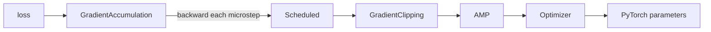

# Optimizer stack

This package provides a small, composable training-optimizer stack for PyTorch. It separates the concerns that are usually mixed into a training loop:

- `Optimizer` is the high-level facade that assembles the complete stack.
- `AMP` adds automatic mixed precision and loss scaling.
- `GradientClipping` clips gradients immediately before the update.
- `Scheduled` advances a learning-rate scheduler after successful updates.
- `GradientAccumulation` controls micro-batches and only updates parameters at accumulation boundaries.

The wrappers can be nested. Each wrapper forwards the optimizer interface to the wrapper inside it and adds one responsibility.

## Design overview



The runtime update path is:

1. `GradientAccumulation.backward(loss)` divides the loss by the number of accumulation steps.
2. The selected optimizer's `backward()` records gradients. With `AMP`, the loss is scaled first.
3. Until the accumulation boundary, no parameter update occurs.
4. At the boundary, `step()` runs:
   - `prepare_step()` — AMP unscales gradients, then clipping modifies them.
   - `update()` — AMP calls `GradScaler.step()` or the base optimizer calls `optimizer.step()`.
   - `after_step(updated)` — the scheduler advances only when an update occurred.
5. Gradients are cleared and accumulation starts again.

## Basic usage

```python
import torch
import torch.nn as nn

from runtime import Runtime
from optimizer.optimizer import Optimizer
model = MyModel().to("cuda")
loss_fn = nn.CrossEntropyLoss()
runtime = Runtime("cuda", amp={"device_type": "cuda", "dtype": torch.float16})

optimizer = Optimizer(
    model.parameters(),
    optimizer_cls=torch.optim.AdamW,
    lr=1e-4,
    weight_decay=0.01,
    runtime=runtime,
    clipping={"max_norm": 1.0},
    scheduler={
        "scheduler_cls": torch.optim.lr_scheduler.StepLR,
        "step_size": 10,
        "gamma": 0.1,
    },
    accumulation_steps=4,
)

for inputs, targets in loader:
    with runtime.autocast():
        logits = model(inputs)
        loss = loss_fn(logits, targets)

    updated = optimizer.backward(loss)
    if updated:
        # An optimizer update has just occurred. This is also the point at
        # which update-based logging or checkpoint bookkeeping can run.
        pass
```

Every feature is optional. For example, clipping without AMP is:

```python
optimizer = Optimizer(
    model.parameters(),
    lr=1e-4,
    clipping={"max_norm": 1.0},
)

loss = loss_fn(model(inputs), targets)
updated = optimizer.backward(loss)
```

Configure AMP once on `Runtime`; omit it there to disable AMP. Pass
`clipping=None` or `scheduler=None` to `Optimizer` to disable those features.
`runtime.autocast()` is a no-op context when AMP is disabled.

Boolean configuration is also supported: pass `True` to enable a feature with
its facade defaults, or `False` to disable it. Feature dictionaries override
those defaults. For clipping, `max_norm` is accepted as an alias for
`max_value`.

## Components

### `BaseOptimizer`

`optimizer/base.py` defines the interface used by the stack:

- `raw_optimizer`: the underlying PyTorch optimizer.
- `backward(loss)`: computes gradients.
- `prepare_step()`: prepares gradients before updating parameters.
- `update() -> bool`: attempts the parameter update and reports whether it happened.
- `after_step(updated)`: performs post-update work.
- `zero_grad()`: clears gradients.
- `step()`: calls `prepare_step()`, `update()`, and `after_step()` in that order.

The boolean returned by `update()` is important for AMP: `GradScaler` can skip an update when gradients contain NaN or infinity.

### `Optimizer`

`optimizer/optimizer.py` exposes the `Optimizer` facade. It accepts normal
PyTorch optimizer arguments plus optional `amp`, `clipping`, `scheduler`, and
`accumulation_steps` configurations. `TorchOptimizer` is the internal
low-level adapter around the actual `torch.optim.Optimizer`.

Use `raw_optimizer` when a scheduler or an integration needs direct access to the underlying PyTorch optimizer.

### `OptimizerWrapper`

`optimizer/wrappers/base.py` forwards the `BaseOptimizer` interface to `inner`. A wrapper should override only the lifecycle method it needs and delegate the rest.

Wrapper order matters because lifecycle calls flow from the outer wrapper inward during preparation and updates, while post-step calls are delegated inward before the outer wrapper performs its own work.

### `AMP`

`optimizer/wrappers/amp.py` provides mixed precision for float16 training:

- `autocast()` creates the PyTorch autocast context.
- `backward()` scales the loss through `torch.amp.GradScaler`.
- `prepare_step()` unscales gradients before clipping or other gradient transforms.
- `update()` invokes `GradScaler.step()` and `GradScaler.update()`.
- It returns `False` if the scaler skipped the update because gradients were non-finite.

AMP is enabled only when both `enabled=True` and `dtype=torch.float16`. For other dtypes, the scaler is disabled while `autocast()` remains available through PyTorch.

### `GradientClipping`

`optimizer/wrappers/clipping.py` clips gradients in `prepare_step()`:

- `clip_type="norm"` calls `clip_grad_norm_` with `max_value` and `norm_type`.
- `clip_type="value"` calls `clip_grad_value_` with `max_value`.

It must wrap AMP, rather than be inside AMP, so AMP unscales gradients before clipping:

```text
GradientClipping(AMP(Optimizer(...)))
```

### `Scheduled`

`optimizer/wrappers/scheduler.py` owns a PyTorch learning-rate scheduler. With `auto_step=True`, it advances the scheduler in `after_step()` only when `updated` is true. This prevents skipped AMP updates from advancing the schedule.

Set `auto_step=False` to control the schedule manually with `scheduler_step(metric=None)`.

### `GradientAccumulation`

`optimizer/gradient_accumulation.py` is a training-loop controller, not an optimizer wrapper. It:

- divides each loss by `accumulation_steps`;
- calls `backward()` for every micro-batch;
- calls `step()` only on the final micro-batch;
- clears gradients and resets the microstep counter after an update;
- returns `False` for intermediate microsteps and the optimizer's update result at the boundary.

The loss division makes the accumulated gradient equal to the average gradient of the group, rather than its sum.

### Distributed training

The optimizer works with a model prepared by the shared `Runtime`:

```python
from runtime import Runtime
from optimizer.optimizer import Optimizer

runtime = Runtime(torch.device("cuda"))
model = runtime.prepare_model(model)
optimizer = Optimizer(model.parameters(), lr=1e-4, accumulation_steps=4)
```

The optimizer does not create or manage the process group; that remains the
responsibility of `Runtime`. DDP synchronizes gradients while the
optimizer handles the update, clipping, AMP, scheduler, and accumulation
state on every rank. With gradient accumulation, synchronization still occurs
on every microstep. A training loop can use DDP's `no_sync()` for intermediate
microsteps when communication optimization is needed.

The CPU DDP integration test can be run with:

```text
torchrun --standalone --nproc_per_node=2 tests/test_ddp.py
```

## Checkpointing

Save the complete wrapper state rather than only the raw optimizer state. A complete checkpoint normally includes the model, optimizer stack, and accumulation position:

```python
checkpoint = {
    "model": model.state_dict(),
    "optimizer": optimizer.state_dict(),
}
torch.save(checkpoint, path)
```

Restore the same wrapper structure before loading the state:

```python
checkpoint = torch.load(path, map_location="cuda")
model.load_state_dict(checkpoint["model"])
optimizer.load_state_dict(checkpoint["optimizer"])
```

This preserves optimizer moments, AMP's loss-scaler state, and the scheduler's counters.

## Important implementation notes

- Call `zero_grad()` only after an accumulation group has completed; `GradientAccumulation` does this automatically.
- Do not call `optimizer.step()` once per micro-batch when using `GradientAccumulation`; call `controller.backward(loss)` instead.
- Use `updated` for update-based logging, checkpoint cadence, and scheduler decisions.
- Construct wrappers once, outside the training loop.
- Keep the parameter iterable available for `GradientClipping`; it materializes the iterable so it can be reused.
- The example file `optimizer/ex.py` contains placeholder `MyModel` and
    `loader` variables that must be replaced by application code.

## Tests

The unit and CUDA integration tests are in `tests/test_optimizer.py`:

```text
pytest tests/test_optimizer.py
```

To run compilation, the unit/CUDA tests, and the two-process CPU DDP test in
one command, run:

```text
python test.py
```

The CUDA test is skipped automatically when CUDA is unavailable. The DDP test
requires `torchrun` with at least two processes and uses the CPU Gloo backend;
it is separate from the regular pytest command because each worker must be
launched by `torchrun`.
